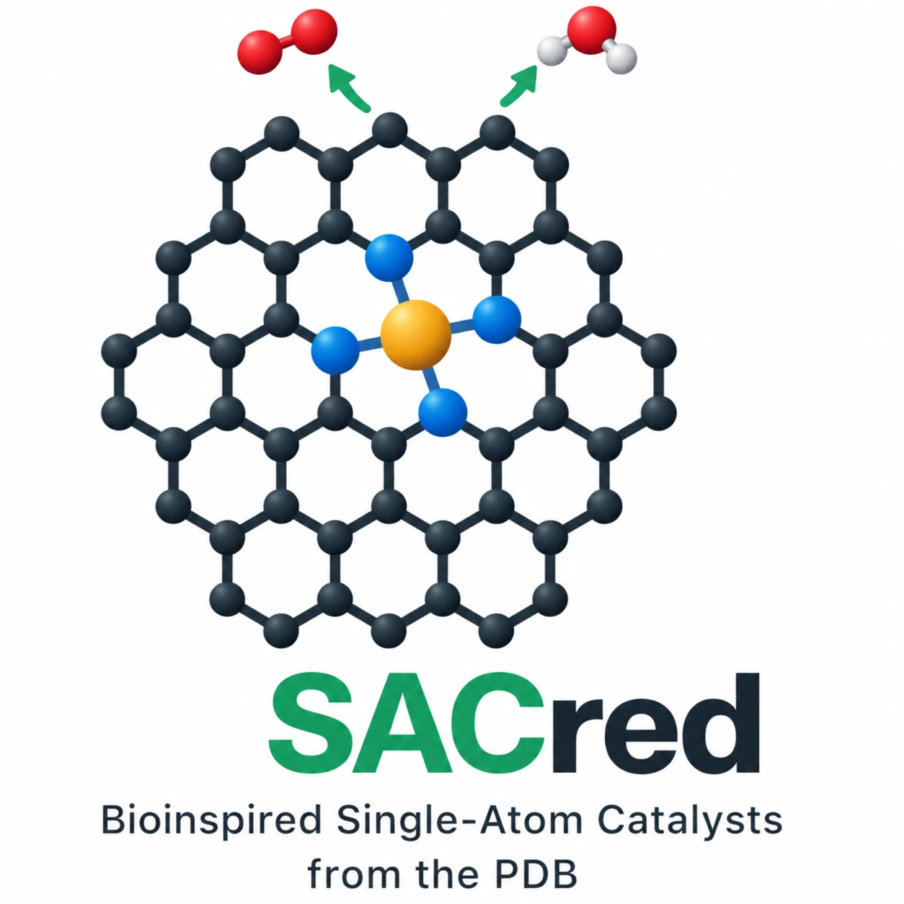

<p align="center"></p>

# SACred: turning enzyme active sites into usable single-atom catalysts

**An agentic AI pipeline and open dataset.** Every transition-metal site in the Protein Data Bank is reduced to its
first coordination shell, rebuilt as a single-atom catalyst (SAC) site in graphene, MoS₂ or silica, screened with
GFN2-xTB and refined with DFT, for activity and for survival in synthesis.

- **Explore the results in your browser:** https://freeedericschubert.github.io/SACred/ (a marimo notebook running in
  WebAssembly; the first visit takes about a minute while Python loads)
- **Dataset:** Zenodo, DOI `10.5281/zenodo.23580900` (database, tables, ~11,000 DFT and ~5,000 xTB structures with energies and forces)

> Hackathon release, October 2026. All results are preliminary drafts that need expert checking.

## Why

Single-atom catalysts use every metal atom, but almost all of them are built from the same few sites (mostly a metal
held by four nitrogens), and many lose their metal during synthesis. Enzymes run hydrogen evolution, O₂ and CO₂
reduction and N₂ fixation on single metals held by many different first shells. SACred uses all of them as templates
and asks two questions per site: is it active, and can it be made?

## Pipeline

| Step | Code |
| --- | --- |
| PDB sweep: every metal site, its first coordination shell, mapping onto graphene single/double vacancies | `bio/pdb_sweep.py`, `bio/first_shell.py`, `bio/validate.py` |
| Mapping onto MoS₂ (metal on three S, S vacancy) and silica (siloxide O) | `bio/supports.py` |
| Graphene site builder (metal + N/S/O/C donors in a 6×6 cell) | `materials/graphene/sites.py` |
| GFN2-xTB funnel: ΔG_H, stability descriptors, O₂/CO₂/N₂ intermediates, supports | `screen/xtb_scan.py`, `screen/xtb_stability.py`, `screen/stability_descriptors.py`, `screen/xtb_reactions.py`, `screen/xtb_supports.py` |
| DFT (Quantum ESPRESSO, PBE-D3, GBRV 40/200 Ry): ΔG_H, formation energy and dissolution potential, ORR, operating conditions, escape paths | `dft/make_inputs.py`, `dft/qe.py`, `dft/curta/`, `dft/analyse.py`, `dft/orr.py`, `dft/conditions.py`, `dft/points.py` |
| Calibration of xTB against DFT (per-metal offsets, leave-one-out error) | `screen/calibrate.py` |
| Second coordination sphere and MD start structures for a MACE force field | `screen/second_sphere.py`, `screen/md_escape.py`, `data/md_start/` |
| Literature checks (OpenAlex/Europe PMC counts; Valency multi-agent screens, results in `data/literature_*.json`) | `lit/novelty.py` |
| Release database (SQLite, Parquet, CSV) and Zenodo package | `db/build.py`, `db/release.py`, `db/DATASHEET.md`, `db/SCHEMA.md` |
| Notebooks, website, figures | `notebooks/`, `site/`, `figures/` |

`dft/runs/` holds the Quantum ESPRESSO inputs of every structure; outputs and relaxation trajectories are in the
Zenodo record.

## Preliminary results

- 291,977 metal sites from the PDB; 1,155 graphene sites in the xTB funnel; 71 refined with DFT.
- **24 usable motifs** bind hydrogen within 0.2 eV of the optimum in DFT; several have no earlier report.
- **Stability is the bottleneck:** most enzyme-like motifs would rather form metal particles; N and C donors hold the
  metal, S and O let it go. The pipeline ranks activity and stability together.
- **Validation:** our DFT reproduces the published O₂-reduction potential of Co–N₄ (0.93 V), and the screen
  independently finds Ni–N₃, which has been made and tested for H₂ evolution.
- **Synthesis:** MD with a MACE force field fine-tuned on our DFT at 1500 K: Zn–NS₂ loses its metal within 0.15 ps,
  Co–N₂OC keeps its donors over 5 ps, as the escape barriers predicted.

## Notebooks

```bash
uv venv .venv && uv pip install --python .venv/bin/python marimo altair pandas pyarrow duckdb
.venv/bin/marimo run notebooks/sacred.py          # the results notebook (also on GitHub Pages)
.venv/bin/marimo run notebooks/sac_pitch.py       # the hackathon pitch
.venv/bin/marimo run notebooks/sac_explorer.py    # full explorer; needs the release database (python db/build.py)
```

The explorer has a chat over the database (`db/ask.py`, Claude writes read-only SQL); it needs your own
`ANTHROPIC_API_KEY` in `notebooks/.env`, which git ignores.

## Running the pipeline

```bash
uv pip install --python .venv/bin/python gemmi ase numpy pandas requests matplotlib scipy tblite
.venv/bin/python bio/pdb_sweep.py && .venv/bin/python bio/first_shell.py
.venv/bin/python screen/xtb_scan.py scan && .venv/bin/python screen/xtb_scan.py table
.venv/bin/python dft/make_inputs.py graphene1      # Quantum ESPRESSO inputs; run them on your cluster (dft/curta/)
.venv/bin/python dft/analyse.py && .venv/bin/python screen/calibrate.py
.venv/bin/python db/build.py                       # release database
```

The DFT scripts were written for the FU Berlin HPC cluster Curta (SLURM); paths to pseudopotentials and the cluster
are set at the top of `dft/qe.py` and in `dft/sync.sh`.

## How we used AI

Claude Opus in Claude Code wrote and ran the pipeline, submitted and monitored the DFT runs and built the notebooks
and reports. Literature agents on Valency (Claude Haiku triage, Claude Sonnet judging, Claude Opus deep reads)
searched for reported SACs, benchmark data and synthesis problems. The MACE-MP-0 force field was fine-tuned on our
DFT frames. We set the questions, made the scientific decisions and checked the results.

## Licences

- Code: MIT (`LICENSE`).
- Dataset on Zenodo (database, tables, results): CC BY 4.0; structure files: CC0 1.0.
- Source structures from the wwPDB archive: CC0 1.0.

We thank the HPC service of FU Berlin for computing time on Curta.
